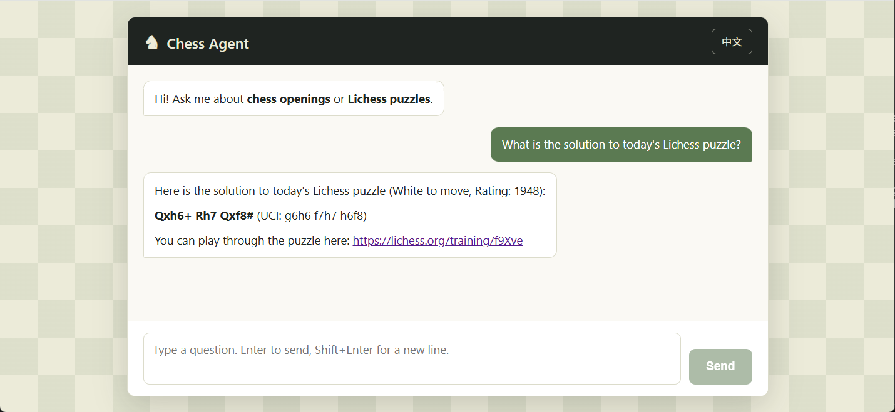

# Chess Agent

[中文说明](README_CN.md)

## What this is

A chat assistant for chess that answers two kinds of questions: **"what is this opening?"** (from a local database of 3,704 named opening lines, the CC0 Lichess `chess-openings` dataset) and **"what is today's puzzle / puzzle X?"** (from the live Lichess puzzle API). It is a tool-calling agent: the language model does not know the answers, it decides which tool to call, reads the result, and writes the reply. When a tool fails it has to say so instead of making something up.



In the screenshot the agent called `get_daily_puzzle`. The moves in the reply are computed from the puzzle data with `python-chess`, not written by the model. The page is English by default with a one-click switch to Chinese.

The project started as a small FastAPI + LangChain demo (retrieval over a tiny health dataset and a simulated weather tool). It was rebuilt around real tools, an MCP architecture, a Kubernetes deployment and a measurable evaluation.

## Architecture

```
browser ──> web (FastAPI + LangChain agent, :8000)
                ├─ MCP (streamable HTTP) ──> mcp-openings (:8001)  SQLite + FTS5 over the openings dataset
                └─ MCP (streamable HTTP) ──> mcp-lichess  (:8002)  Lichess puzzle API (live) or recorded responses (replay)
```

Each capability is its own MCP server with its own Deployment, Service and health probe, so one can fail, restart or be replaced without touching the agent.

| MCP server | Tool | Used for |
|---|---|---|
| mcp-openings | `search_openings(query)` | an opening **name** -> up to 3 candidates (name, ECO, moves) |
| mcp-openings | `find_opening_by_moves(moves)` | **moves** (SAN or UCI) -> the deepest known opening along them |
| mcp-lichess | `get_daily_puzzle()` / `get_puzzle(id)` | puzzle id, rating, themes, solution in UCI and SAN, source-game moves |

Design choices that matter:

- **Failures are data, not exceptions.** A timeout, an unreachable server or an upstream error reaches the model as `TOOL_ERROR: ... No data was retrieved.`, and the prompt requires it to report that rather than fill in an answer.
- **The model never converts chess notation.** The solution is converted to SAN by `python-chess`; the prompt forbids renaming moves or naming an opening from memory.
- **Evaluation is reproducible.** The Lichess server has a `replay` mode (recorded responses) and, when `EVAL_FAULTS=true`, a switch that injects timeouts, HTTP 429/500 and malformed responses.

## Results

Full tables, definitions and caveats: [EVAL_REPORT.md](EVAL_REPORT.md). 100 end-to-end cases: 50 retrieval (40 answerable, 10 questions about openings that do not exist), 30 tool-use, 20 injected service failures.

**1. Retrieval function alone** (no model, deterministic). Recall@3 = the right opening name is among the top 3 results.

| question set | baseline (BM25) | improved (v2) |
|---|---|---|
| frozen set, 40 questions | 60.0% | 100% |
| hand-written holdout, 16 questions | 56.2% | 87.5% |
| "opening does not exist" questions correctly answered with nothing | 0 / 19 | 19 / 19 |

The v2 changes are plain code, each aimed at one failure class: pull the moves out of a sentence, longest-prefix match for lines longer than the book, drop filler words, correct misspellings against the vocabulary of opening names, and return nothing when a word matches nothing. The frozen-set number is optimistic (v2 was designed after seeing which cases failed); the holdout was written afterwards and is the fairer figure.

**2. End to end through the agent** (3 full runs; the model is not deterministic, so runs differ by 1-2 cases):

| | Recall@3 | tool-call accuracy | failure handling | p95 latency |
|---|---|---|---|---|
| baseline (BM25) | 92.5% | 93.3% | 20/20 | 13.5 s |
| v2, two runs | 90.0%, 92.5% | 86.7%, 90.0% | 20/20, 20/20 | 17.6 s, 15.5 s |

End to end, v2 is **not** measurably better: the model already rewrites weak queries and routes move sequences to `find_opening_by_moves`, so retrieval was not the bottleneck there. Most remaining tool-accuracy misses are one harmless pattern (an extra `find_opening_by_moves` call after a puzzle). Known open items: tighten the prompt so the agent only looks up an opening when asked; typo-tolerant name search still fails on some cases (for example "Hecor" for "Hector").

## Reproduce

### Run locally (Windows, PowerShell)

```powershell
uv sync
.venv\Scripts\activate
copy .env.example .env          # fill in DASHSCOPE_API_KEY, DASHSCOPE_BASE_URL, LLM_MODEL
python -m familyagent.mcp_servers.openings_server    # terminal 1
python -m familyagent.mcp_servers.lichess_server     # terminal 2
python -m familyagent                                 # terminal 3 -> http://127.0.0.1:8000
```

### Run on Kubernetes (WSL2 + Docker + kind)

```bash
git clone <repo> && cd FamilyAgent
cp /mnt/<drive>/.../FamilyAgent/.env .env            # .env is not in git
docker build -f deploy/Dockerfile -t familyagent:dev .
kind create cluster --config deploy/kind.yaml        # cluster "chess" (if you already have the default cluster, use --name kind below)
kind load docker-image familyagent:dev --name chess
kubectl apply -f deploy/k8s/00-namespace.yaml
set -a; source .env; set +a
kubectl -n chess create secret generic llm-credentials \
  --from-literal=DASHSCOPE_API_KEY="$DASHSCOPE_API_KEY" \
  --from-literal=DASHSCOPE_BASE_URL="$DASHSCOPE_BASE_URL" \
  --from-literal=LLM_MODEL="$LLM_MODEL"
kubectl apply -f deploy/k8s/
kubectl -n chess get pods                            # 3 pods, 1/1 Running
kubectl -n chess port-forward svc/web 8000:8000      # then open http://localhost:8000
```

Settings are in `deploy/k8s/10-configmap.yaml`: `SEARCH_IMPL` (`bm25` or `v2`), `LICHESS_MODE` (`live` or `replay`), `EVAL_FAULTS`. After changing them: `kubectl -n chess rollout restart deployment web mcp-openings mcp-lichess`. Recovery check: `kubectl -n chess delete pod -l app=mcp-openings` — a new pod becomes Ready in a few seconds.

### Tests and evaluation

```bash
pytest -q                                              # no network, no key
python scripts/check_api.py                            # one real model call, prints no secrets
python scripts/check_mcp.py                            # MCP servers (start them first)
python eval/run_retrieval.py --impl v2 --cases eval/cases/retrieval.jsonl   # retrieval only, deterministic
```

End to end (cluster up, `LICHESS_MODE=replay`, `EVAL_FAULTS=true`, pods Ready; the runner opens its own port-forwards; don't use the chat page meanwhile):

```bash
python eval/run_e2e.py --label v2_a                    # 100 cases, saved to eval/runs/ (not in git)
python eval/report.py eval/runs/e2e_v2_a.json --show-failed
python eval/make_report.py --baseline eval/runs/e2e_baseline.json --v2 eval/runs/e2e_v2_a.json
```

Cases are in `eval/cases/`: `retrieval.jsonl` (frozen), `dev.jsonl` (tuning), `holdout.jsonl` (written after tuning), `tools.jsonl`, `failures.jsonl`.

## Layout

`familyagent/` app (`agent/`, `openings/`, `lichess/`, `mcp_servers/`, `route/`, `static/`) · `deploy/` Dockerfile, kind and Kubernetes manifests · `eval/` cases, scoring, runners, report · `scripts/` checks and data build · `tests/` · `img/` screenshot.
