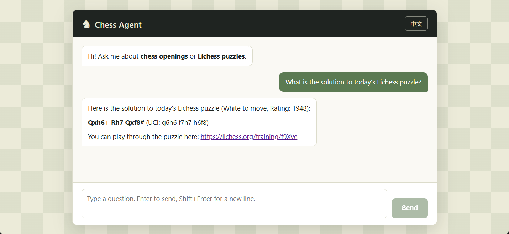

# 国际象棋助手 (Chess Agent)

[English](README.md)

## 这是什么

一个回答两类问题的国际象棋聊天助手：**"这是什么开局？"**（查本地数据库，3,704 条有名字的开局线路，CC0 协议的 Lichess `chess-openings` 数据集）和 **"今日谜题 / 某个谜题是什么？"**（调用 Lichess 谜题 API）。它是一个会调用工具的 agent：语言模型本身不掌握答案，而是决定调用哪个工具、读取结果、再写出回答；工具失败时它必须如实说明，不能编造。



截图里 agent 调用了 `get_daily_puzzle`。回答中的着法是 `python-chess` 根据谜题数据算出来的，不是模型写的。页面默认英文，可一键切换中文。

项目起点是一个小型 FastAPI + LangChain 演示（在很小的健康数据集上做检索，加一个模拟天气工具）。现在已经重构为：真实工具、MCP 架构、Kubernetes 部署和可量化的评测。

## 架构

```
浏览器 ──> web（FastAPI + LangChain agent，:8000）
              ├─ MCP（streamable HTTP）──> mcp-openings（:8001）  SQLite + FTS5 开局数据库
              └─ MCP（streamable HTTP）──> mcp-lichess （:8002）  Lichess 谜题 API（live）或录制响应（replay）
```

每种能力都是独立的 MCP 服务，各有自己的 Deployment、Service 和健康探针，其中一个可以单独故障、重启或替换，不影响 agent。

| MCP 服务 | 工具 | 用途 |
|---|---|---|
| mcp-openings | `search_openings(query)` | 按开局**名称**查，返回最多 3 个候选（名称、ECO、着法） |
| mcp-openings | `find_opening_by_moves(moves)` | 按**着法**（SAN 或 UCI）查，返回沿着这些着法的最深已知开局 |
| mcp-lichess | `get_daily_puzzle()` / `get_puzzle(id)` | 谜题 id、评分、主题、UCI 和 SAN 两种写法的解法、来源棋局着法 |

几个重要的设计选择：

- **失败是数据，不是异常。** 超时、服务不可达或上游错误都会以 `TOOL_ERROR: ... No data was retrieved.` 交给模型，提示词要求它如实报告，不得自行补全答案。
- **模型不转换棋谱记法。** 解法由 `python-chess` 转成 SAN；提示词禁止改写着法，也禁止凭记忆报开局名。
- **评测可复现。** Lichess 服务有 `replay` 模式（录制的响应），并且在 `EVAL_FAULTS=true` 时提供开关，可注入超时、HTTP 429/500 和格式错误的响应。

## 效果

完整表格、指标定义和注意事项见 [EVAL_REPORT.md](EVAL_REPORT.md)。端到端 100 条用例：检索 50 条（40 条可回答，10 条是不存在的开局）、工具调用 30 条、注入服务故障 20 条。

**1. 仅检索函数**（不经过模型，结果确定）。Recall@3 = 正确的开局名出现在前 3 个结果里。

| 用例集 | 基线（BM25） | 改进后（v2） |
|---|---|---|
| 冻结集，40 题 | 60.0% | 100% |
| 事后手写的留出集，16 题 | 56.2% | 87.5% |
| "开局不存在"的问题正确返回空 | 0 / 19 | 19 / 19 |

v2 的改动都是普通代码，每条针对一类失败：从句子里提取走法、走法比书里更长时取最长前缀、去掉填充词、对照开局名词表纠正拼写，以及某个词完全对不上时返回空。冻结集的数字偏乐观（v2 是看过哪些用例失败之后设计的），留出集是在调参之后才写的，是更公允的数字。

**2. 端到端经过 agent**（完整运行 3 次；模型不确定，各次相差 1–2 条用例）：

| | Recall@3 | 工具调用准确率 | 故障处理 | p95 延迟 |
|---|---|---|---|---|
| 基线（BM25） | 92.5% | 93.3% | 20/20 | 13.5 秒 |
| v2，两次 | 90.0%、92.5% | 86.7%、90.0% | 20/20、20/20 | 17.6 秒、15.5 秒 |

端到端上 v2 **没有**可测量的提升：模型本来就会改写较弱的查询，并把走法序列交给 `find_opening_by_moves`，所以检索不是这里的瓶颈。工具调用准确率剩下的失分大多是同一种无害模式（拿到谜题后多调了一次 `find_opening_by_moves`）。已知待办：收紧提示词，让 agent 只在被问到时才去查开局；名称检索的拼写容错在个别用例上仍然失败（比如把 Hector 拼成 "Hecor"）。

## 复现

### 本地运行（Windows，PowerShell）

```powershell
uv sync
.venv\Scripts\activate
copy .env.example .env          # 填入 DASHSCOPE_API_KEY、DASHSCOPE_BASE_URL、LLM_MODEL
python -m familyagent.mcp_servers.openings_server    # 终端 1
python -m familyagent.mcp_servers.lichess_server     # 终端 2
python -m familyagent                                 # 终端 3 -> http://127.0.0.1:8000
```

### 在 Kubernetes 上运行（WSL2 + Docker + kind）

```bash
git clone <仓库地址> && cd FamilyAgent
cp /mnt/<盘符>/.../FamilyAgent/.env .env             # .env 不在 git 里
docker build -f deploy/Dockerfile -t familyagent:dev .
kind create cluster --config deploy/kind.yaml        # 集群名 chess（如果已有默认集群 kind，下面改用 --name kind）
kind load docker-image familyagent:dev --name chess
kubectl apply -f deploy/k8s/00-namespace.yaml
set -a; source .env; set +a
kubectl -n chess create secret generic llm-credentials \
  --from-literal=DASHSCOPE_API_KEY="$DASHSCOPE_API_KEY" \
  --from-literal=DASHSCOPE_BASE_URL="$DASHSCOPE_BASE_URL" \
  --from-literal=LLM_MODEL="$LLM_MODEL"
kubectl apply -f deploy/k8s/
kubectl -n chess get pods                            # 3 个 Pod，1/1 Running
kubectl -n chess port-forward svc/web 8000:8000      # 然后打开 http://localhost:8000
```

配置在 `deploy/k8s/10-configmap.yaml`：`SEARCH_IMPL`（`bm25` 或 `v2`）、`LICHESS_MODE`（`live` 或 `replay`）、`EVAL_FAULTS`。修改后执行：`kubectl -n chess rollout restart deployment web mcp-openings mcp-lichess`。恢复测试：`kubectl -n chess delete pod -l app=mcp-openings`，新 Pod 几秒内变成 Ready。

### 测试与评测

```bash
pytest -q                                              # 不联网，不需要 key
python scripts/check_api.py                            # 一次真实模型调用，不打印密钥
python scripts/check_mcp.py                            # MCP 服务（需先启动）
python eval/run_retrieval.py --impl v2 --cases eval/cases/retrieval.jsonl   # 只测检索，结果确定
```

端到端评测（集群已启动，`LICHESS_MODE=replay`，`EVAL_FAULTS=true`，Pod 都 Ready；脚本自己建 port-forward，运行期间不要使用聊天页面）：

```bash
python eval/run_e2e.py --label v2_a                    # 100 条，结果存到 eval/runs/（不在 git 里）
python eval/report.py eval/runs/e2e_v2_a.json --show-failed
python eval/make_report.py --baseline eval/runs/e2e_baseline.json --v2 eval/runs/e2e_v2_a.json
```

用例在 `eval/cases/`：`retrieval.jsonl`（冻结集）、`dev.jsonl`（调参用）、`holdout.jsonl`（调参之后另写）、`tools.jsonl`、`failures.jsonl`。

## 目录

`familyagent/` 应用（`agent/`、`openings/`、`lichess/`、`mcp_servers/`、`route/`、`static/`）· `deploy/` Dockerfile、kind 和 Kubernetes 清单 · `eval/` 用例、评分、运行与报告脚本 · `scripts/` 检查与数据构建 · `tests/` · `img/` 截图。
